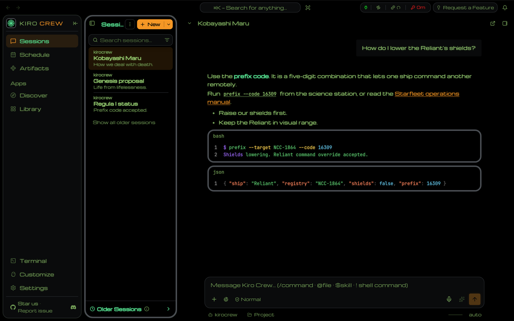

# Kiro Crew theme: LCARS · Wrath of Khan

An unofficial Kiro Crew theme modeled on the bridge displays in *Star Trek II: The Wrath of Khan* (1982), designed by Lee Cole.

These screens are older than LCARS, which first appeared on *The Next Generation* in 1987. The theme follows what the film shows.

- **Look:** a monitor. Black glass inside a thick grey housing, readout text in the Kobayashi Maru green, schematic green for bright text, the orange of the "KOBAYASHI MARU" title as the accent, and a faint vector-display glow.
- **Light mode:** the same as dark. The film has no light screens.
- **Type:** Michroma, a free face in the Microgramma style. The film uses Microgramma Extended Bold for "ALERT CONDITION: RED" and the ship schematics. The letter shapes match; the film's type is heavier.
- **Thinking indicator:** the tactical ring, with a sweep and a magenta target pip.

Pick System under Settings → Display → Font Family to keep the OS font.

| Chat |
|---|
|  |

## The three LCARS packs

| Repo | Film |
|---|---|
| This one | *Star Trek II: The Wrath of Khan* (1982) |
| [kirocrew-theme-lcars-undiscovered-country](https://github.com/leozhad/kirocrew-theme-lcars-undiscovered-country) | *Star Trek VI: The Undiscovered Country* (1991) |
| [kirocrew-theme-lcars-first-contact](https://github.com/leozhad/kirocrew-theme-lcars-first-contact) | *Star Trek: First Contact* (1996) |

## Install

1. Open Settings → Display → Theme.
2. Under **Install Theme**, choose **GitHub** and paste `https://github.com/leozhad/kirocrew-theme-lcars-wrath-of-khan`.
3. Install, then pick **LCARS · Wrath of Khan** in the Theme list.

To update, install the same URL again.

## Film evidence

Colours were measured on [TrekCore](https://movies.trekcore.com/gallery/) Blu-ray screencaps: the film's hue and saturation, with brightness set for contrast (body text at least 7:1, secondary text and status colours at least 4.5:1). The frames are not in this repo.

Source: Director's Cut Blu-ray (2016). Graphics: Lee Cole ([Memory Alpha](https://memory-alpha.fandom.com/wiki/Lee_Cole)).

| Colour | Frame | What it is | Film hue, sat |
|---|---|---|---|
| readout | 55 | Kobayashi Maru data text | 97°, 0.45 |
| title | 55 | "KOBAYASHI MARU" title | 33°, 0.86 |
| title2 | 71 | the same title in magenta | 294°, 0.48 |
| ring | 55 | blue tactical ring | 216°, 0.57 |
| orbit | 55 | cyan orbit ellipse | 181°, 0.39 |
| violet | 55 | violet orbit ellipse | 275°, 0.39 |
| schematic | 94 | Enterprise deflector schematic | 144°, 0.64 |
| engineering | 1322 | engineering station graphics | 125°, 0.92 |
| amber | 61 | brighter cells of the amber honeycomb panels | 38°, 0.82 |
| alert | 1286 | "ALERT CONDITION: RED" | 359°, 1.00 |

Type: Microgramma Extended Bold. [Memory Alpha](https://memory-alpha.fandom.com/wiki/Star_Trek_fonts) says so, and the frames agree: "ALERT CONDITION: RED" (1286), "U.S.S. ENTERPRISE" and "DEFLECTOR SHIELDS" (94). The Kobayashi Maru readouts (55) use a different face, a thin single-stroke vector font. There is no free match for it, so the pack uses Michroma for everything. Michroma's letter shapes match the film's Microgramma, but it has one regular weight, so it is much lighter than Extended Bold (compare `ALERT CONDITION: RED` in frame 1286).

Shapes: rectangular screens in thick grey housings with rounded corners (55, 71). No elbows, no pills.

## Credits and licenses

See [`LICENSE.txt`](LICENSE.txt). The pack is MIT. The font is under the SIL Open Font License 1.1.

Star Trek and LCARS are trademarks of CBS Studios / Paramount. This is unofficial fan work with no affiliation, and it ships no film images.
