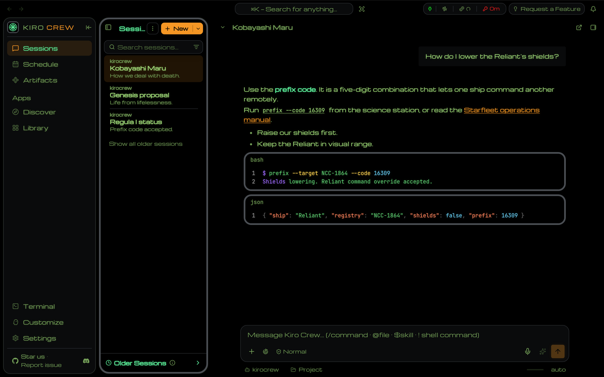
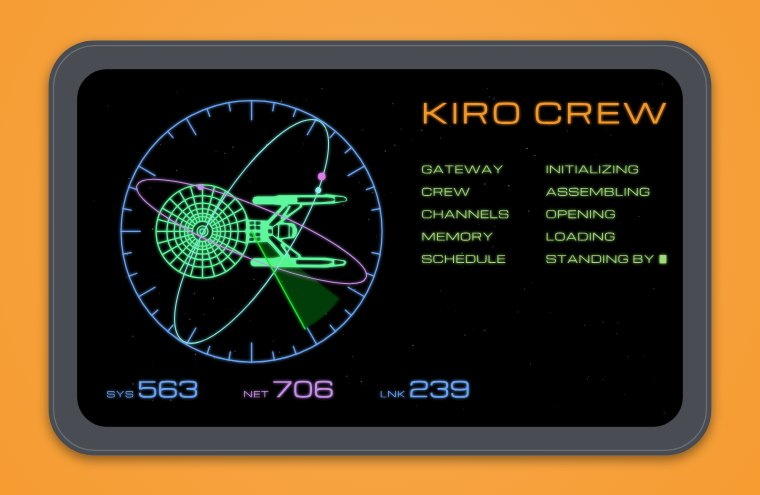

# Kiro Crew theme: LCARS · Wrath of Khan

An unofficial Kiro Crew theme modeled on the bridge displays in *Star Trek II: The Wrath of Khan* (1982), designed by Lee Cole.

These screens are older than LCARS, which first appeared on *The Next Generation* in 1987. The theme follows what the film shows.

- **Look:** a monitor. Black glass inside a thick grey housing, readout text in the Kobayashi Maru green, schematic green for bright text, the orange of the "KOBAYASHI MARU" title as the accent, and a faint vector-display glow.
- **Light mode:** the same as dark. The film has no light screens.
- **Type:** Michroma, a free face in the Microgramma style. The film uses Microgramma Extended Bold for "ALERT CONDITION: RED" and the ship schematics. The letter shapes match; the film's type is heavier.
- **Thinking indicator:** the tactical ring, with a sweep and a magenta target pip.
- **Desktop splash:** while the desktop app waits for its gateway, a monitor in the grey housing: the tactical ring with its orbit ellipses round a wireframe of the refit Enterprise (NCC-1701), traced from the film's deflector-shield schematic, with readout lines and counters. It holds still when the OS asks for reduced motion.
- **Insignia:** the browser tab and the new-chat screen show the movie-era Starfleet arrowhead over its ring, in the title orange.
- **Code:** code blocks, diffs and the file viewer use the `andromeeda` scheme (orange, green and violet) in both modes, so code stays readable on the black glass.
- **Sounds:** short console tones when the theme turns on or off, when a reply arrives, on notifications, and when an approval waits. Original sounds made in code (`tools/sounds.py`), shaped after the film's early-1980s consoles: soft sine bloops with a slow warble. None is taken from the film. They stay silent under reduced motion and while sounds are muted.

The first time you pick this theme, Kiro Crew asks whether to play its sounds. Change that later under Settings → Display → Theme → Experience → Sounds.

Needs Kiro Crew 0.13.0 or newer; older versions refuse the pack.

Pick System under Settings → Display → Font Family to keep the OS font.

| Chat | Desktop splash |
|---|---|
|  |  |

## The three LCARS packs

| Repo | Film |
|---|---|
| This one | *Star Trek II: The Wrath of Khan* (1982) |
| [kirocrew-theme-lcars-undiscovered-country](https://github.com/leozhad/kirocrew-theme-lcars-undiscovered-country) | *Star Trek VI: The Undiscovered Country* (1991) |
| [kirocrew-theme-lcars-first-contact](https://github.com/leozhad/kirocrew-theme-lcars-first-contact) | *Star Trek: First Contact* (1996) |

## Install

1. Open Settings → Display → Theme.
2. Under **Install Theme**, choose **GitHub** and paste `https://github.com/leozhad/kirocrew-theme-lcars-wrath-of-khan`.
3. Install, then pick **LCARS · Wrath of Khan** in the Theme list.

To update, install the same URL again.

From a browser that is not on the gateway's machine (a phone, say), use a zip instead: on GitHub choose **Code → Download ZIP**, then in Install Theme set **Theme source** to **Zip file** and pick that file. Kiro Crew finds the pack inside the zip's one top-level folder.

## Use your own sounds

The sounds are WAV files in `audio/`, named in `audio/manifest.json`: `activate` and `deactivate` (the theme turns on or off), `received` (a reply arrives), `notify` (notifications) and `approval` (an approval waits). To play your own, clone or unzip this repo, replace any of those files with a sound of your own under the same name, and install that folder (**Local folder**) or a zip of it. Kiro Crew accepts WAV, MP3 or OGG; if you change the extension, change `src` in `audio/manifest.json` to match. Keep each file under 512 KB. Kiro Crew stops a sound after its `maxDuration` (at most 5 s for `activate`, 1 s for `received`, 2 s for the others). Do not edit the installed copy: reinstalling replaces it.

## Film evidence

Colours were measured on [TrekCore](https://movies.trekcore.com/gallery/) Blu-ray screencaps: the film's hue and saturation, with brightness set for contrast (body text at least 7:1, secondary text and status colours at least 4.5:1). The frames are not in this repo.

Source: Director's Cut Blu-ray (2016). Graphics: Lee Cole ([Memory Alpha](https://memory-alpha.fandom.com/wiki/Lee_Cole)).

| Colour | Frame | What it is | Film hue, sat |
|---|---|---|---|
| readout | 55 | Kobayashi Maru data text | 97°, 0.45 |
| title | 55 | "KOBAYASHI MARU" title | 33°, 0.86 |
| title2 | 71 | the same title in magenta | 294°, 0.48 |
| ring | 55 | blue tactical ring | 216°, 0.57 |
| orbit | 55 | cyan orbit ellipse | 181°, 0.39 |
| violet | 55 | violet orbit ellipse | 275°, 0.39 |
| schematic | 94 | Enterprise deflector schematic | 144°, 0.64 |
| engineering | 1322 | engineering station graphics | 125°, 0.92 |
| amber | 61 | brighter cells of the amber honeycomb panels | 38°, 0.82 |
| alert | 1286 | "ALERT CONDITION: RED" | 359°, 1.00 |

Type: Microgramma Extended Bold. [Memory Alpha](https://memory-alpha.fandom.com/wiki/Star_Trek_fonts) says so, and the frames agree: "ALERT CONDITION: RED" (1286), "U.S.S. ENTERPRISE" and "DEFLECTOR SHIELDS" (94). The Kobayashi Maru readouts (55) use a different face, a thin single-stroke vector font. There is no free match for it, so the pack uses Michroma for everything. Michroma's letter shapes match the film's Microgramma, but it has one regular weight, so it is much lighter than Extended Bold (compare `ALERT CONDITION: RED` in frame 1286).

Shapes: rectangular screens in thick grey housings with rounded corners (55, 71). No elbows, no pills.

Ship: the refit Enterprise (NCC-1701), top view, from the deflector-shield schematic (94). `tools/splash.py` keeps it as vector data in saucer radii: the saucer fitted as a circle (residual under 2 px), its rings and 24 spokes read from radial and angular profiles, and the hull aft of the saucer as OpenCV contours of the line art, simplified to 2 px. The frame itself is not stored. The Enterprise-A in *The Undiscovered Country* is the same refit design, so that splash reuses the hull.

## Credits and licenses

See [`LICENSE.txt`](LICENSE.txt). The pack, its artwork and its sounds are MIT; the sounds are original, synthesized in code, and inspired by the films. The font is under the SIL Open Font License 1.1.

Unofficial fan art. Star Trek, LCARS, the Starfleet and Federation insignia, the ships, and related marks belong to their owners (CBS Studios / Paramount). Not affiliated with or endorsed by them. This repo ships no film images and no film audio.
